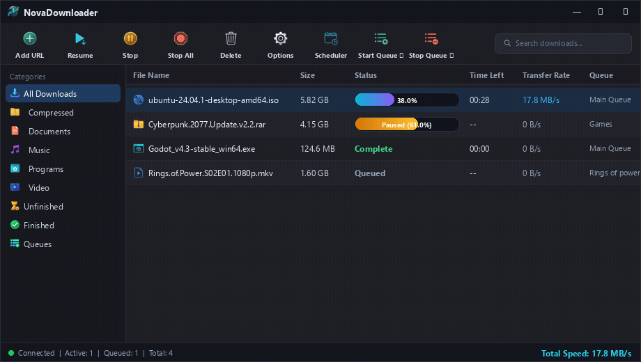
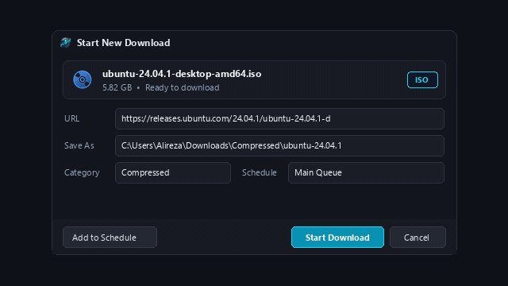
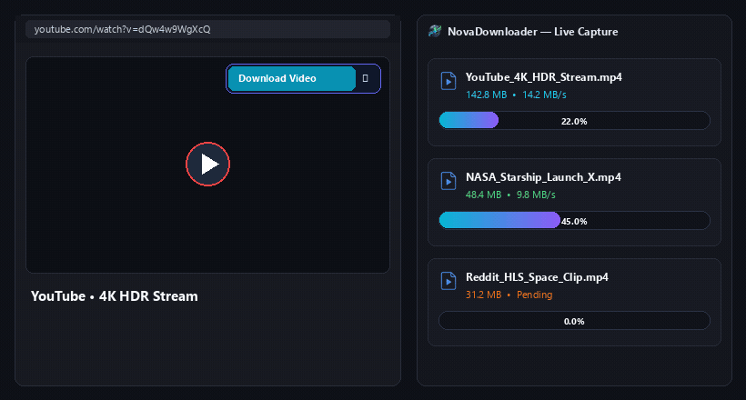

# ⚡ NovaDownloader

**NovaDownloader** is an ultra-fast, modern, multi-segmented Internet Download Manager & Media Stream Grabber written in **C# / .NET 10** for Windows.

Designed as a modern Dark Fluent alternative to legacy download managers like IDM, NovaDownloader combines multi-connection HTTP downloads, HLS/streaming video capture, YouTube/video-site extraction, named download schedules, and seamless browser integration.

---

## 🎬 Showcase

### Main Dashboard (Downloading, Paused, Completed & Queued)


### Compact Start, Progress & Finish Dialogs


### YouTube, X & Reddit Stream Capture


---

## 🌟 Key Features

1. **High-Performance Multi-Segment Engine (`NovaDownloader.Core`)**:
   - Up to 16 configurable parallel download connections per file using `SocketsHttpHandler`.
   - Direct zero-copy disk writes with `RandomAccess` to eliminate memory spikes and slow merge phases.
   - Live global **Speed Limiter** (bandwidth cap in KB/s), custom **User-Agent**, and **HTTP/SOCKS Proxy** support.
   - Resilient pause & resume with atomic JSON session persistence (`%LocalAppData%\NovaDownloader\downloads.json`).

2. **Advanced Media & Stream Grabber (`NovaDownloader.Media` & `YtDlpService`)**:
   - Full support for **HLS (`.m3u8`)** playlists with parallel `.ts`/`.m4s` segment fetching, AES-128 decryption, and `ffmpeg.exe` muxing.
   - Integrated `yt-dlp.exe` support for YouTube (including **YouTube Shorts**), Aparat, Vimeo, TikTok, Instagram, and X with live progress and pause/resume.

3. **Browser Extension & Selection Link Grabber (`extension/` & `NovaDownloader.ExtensionHost`)**:
   - **Floating Video Grabber:** IDM-style floating download bar above HTML5 video players and YouTube Shorts with quality selection.
   - **Selection Link Grabber:** Highlight/select links on any webpage to show a floating **Download with NovaDownloader** pill, opening a modern **Batch Download** window with live size probing and smart filtering (auto-hides `.html`, images, and duplicates).
   - **Native Messaging & Named Pipe IPC:** Connects Chrome, Edge, Opera, Brave, and Vivaldi to the desktop app via `NovaDownloaderIpcPipe` (with offline queue fallback and auto-launch).

4. **Named Schedules & Queues (`SchedulerDialog`, `QueueSchedulerService`)**:
   - Create custom named queues/schedules (e.g., `Main Queue`, `Games`, `Movies`) with per-queue concurrency (`1–10` files at once) and `Daily`, `One-Time`, or `Selected Days` start/stop schedules.
   - Start or stop individual queues directly from the toolbar (**Start Queue ▾** / **Stop Queue ▾**) or the **System Tray** menu.

5. **Modern Dark Fluent UI (`NovaDownloader.UI`)**:
   - Compact **Start Download**, **During Download** (`FluidProgressBar`), and **Finish Download** dialogs with multi-monitor placement (opens on the active browser's monitor without popping up a hidden main window).
   - `Ctrl+Click` / `Shift+Click` / `Ctrl+A` multi-selection with a 3-button crash-safe **Delete** dialog (`Delete from List`, `Delete File & List`, `Cancel`).
   - Tabbed **Options** window (**General**, **Folders & Types**, **Speed & Network**, **Browser & Tools**) with **Launch on Windows Startup** (`--minimized` to System Tray), custom category folders/extensions, duplicate-file handling, completion sound, and `.zip` auto-extraction.

---

## 🚀 Quick Start

### 1. Build & Run the Desktop App
Double-click `run_app.bat` or run:
```powershell
dotnet build NovaDownloader.slnx -c Debug
dotnet run --project src/NovaDownloader.UI/NovaDownloader.UI.csproj
```

### 2. Install Browser Integration (Chrome, Edge, Opera, Brave, Vivaldi)
Double-click `install_browser_extension.bat` or use **Options → Browser & Tools → Setup Extension...**, then load the `extension/` folder unpacked in `chrome://extensions` / `opera://extensions` / `edge://extensions` with **Developer Mode** enabled.
